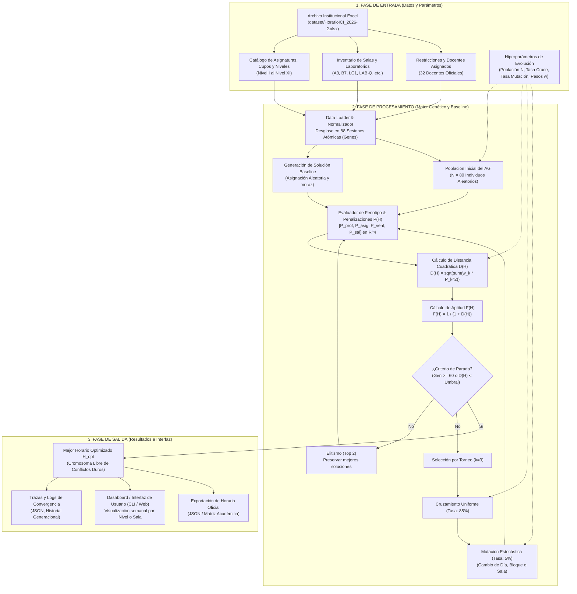

# Diagrama de Flujo General del Sistema EvoSchedule

A continuación se detalla la arquitectura de extremo a extremo del sistema de optimización de horarios universitarios, dividida en sus tres fases fundamentales: **Entrada**, **Procesamiento** y **Salida**.

---

## Explicación Detallada de Componentes

### 1. Entrada (Input)
* **Dataset Excel (`HorarioICI_2026-2.xlsx`):** Contiene la programación histórica y las tablas de carga académica de los 5 niveles (I al XI) de Ingeniería Civil Informática.
* **Extracción Normalizada:** Se procesa sin dependencias binarias externas, garantizando portabilidad multiplataforma.
* **Configuración del Problema:** Matriz de 8 bloques diarios (80 minutos c/u) $\times$ 5 días hábiles (Lunes a Viernes) y 17 aulas/laboratorios físicos.

### 2. Procesamiento (Processing)
* **Baseline:** Permite establecer una cota inferior de rendimiento estocástico evaluando 30 asignaciones aleatorias independientes.
* **Algoritmo Genético:**
  * **Cromosoma:** Array de $m = 88$ tuplas atómicas $t_i = (dia, bloque, duracion, profesor, asignatura, sala)$.
  * **Evaluación Multiobjetivo:** Penalizaciones agrupadas por índice hash en tiempo casi-lineal para las 4 restricciones: $P_{prof}, P_{asig}, P_{vent}, P_{sal}$.
  * **Operadores:** Torneo determinista de 3 contendientes, recombinación uniforme para conservar bloques válidos y mutación estocástica.

### 3. Salida (Output)
* **Horario Semanal Libre de Conflictos Duros:** Cero solapamientos de profesor ($P_{prof}=0$), cero choques de materias del mismo nivel ($P_{asig}=0$) y cero conflictos de sala ($P_{sal}=0$).
* **Métricas y Trazas:** Almacenamiento en `logs/` con formato JSON estructurado.
* **Interfaz de Usuario:** Prototipo funcional interactivo en terminal y compatible con frontend web.
